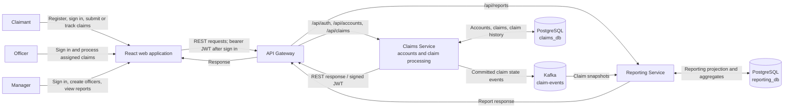
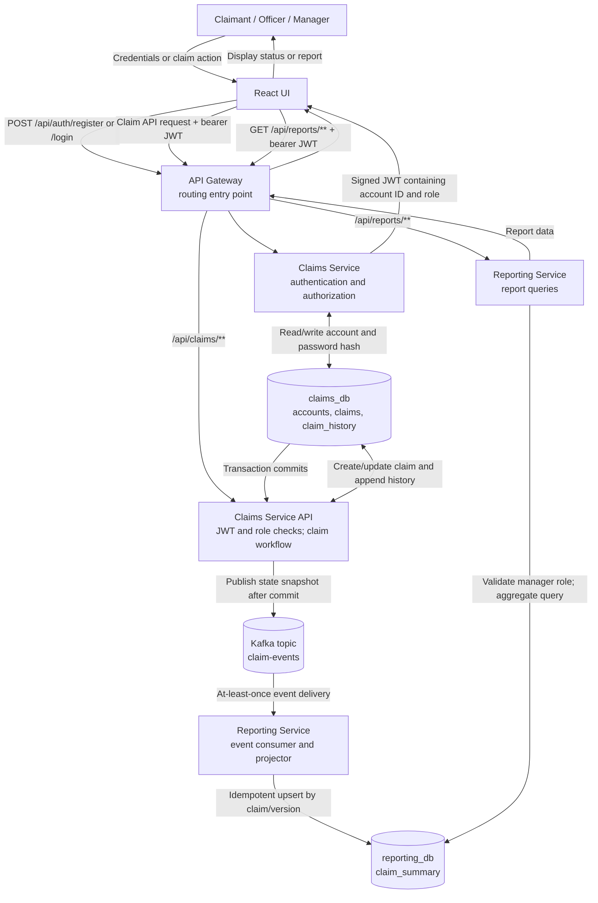

# Claims Platform Data Flow Diagram

## Level 0: System context

Claimants, officers, and managers use the React application. Requests pass through the API gateway to the service that owns the requested data. Claims are stored by claims-service and then published to Kafka for reporting-service to project into its own database.

## Level 1: Claim submission and reporting flow

## Data-flow notes

- Claims-service owns accounts, claims, and the claim history in `claims_db`. Passwords are stored as BCrypt hashes.
- Registration creates claimant accounts. The initial manager is bootstrapped from environment settings, and managers create officer accounts.
- Login returns a signed JWT. The React app stores it and sends it as a bearer token; claims-service and reporting-service validate the token and enforce role permissions.
- Claims-service is the authoritative write path. It publishes claim state snapshots to Kafka after the database transaction commits.
- Reporting-service consumes those events and upserts a projection in `reporting_db`. Reports can lag behind recent claim changes while the event is being processed.
- Reports read the reporting projection; claim workflow and account operations use claims-service.
